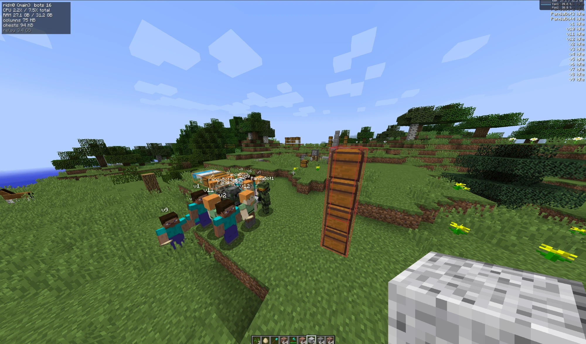
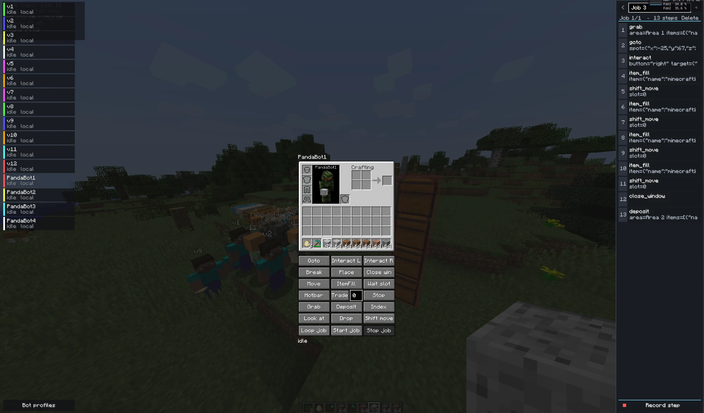

# LargeArrayHandler

Mod de Minecraft 1.12.2 (Fabric / Legacy Fabric).

- `common/`: lógica del mod (bots, jobs, protocolo) y el código JS de los bots (`common/src/main/resources/bot`).
- `versions/1.12.2/`: cliente del mod especifico para 1.12.2.

Los bots corren en Node.js y se comunican con el mod por sockets; el pathfinding usa `mineflayer-pathfinder`.

El mundo vive en un shm entre java y node para un uso eficiente de memoria.

Actualmente en desarollo, por ahora solo hay movimientos primitivos como manejo de inventario o moverse por el mundo, y jobs que son secuencias de primitivos, mas adelante voy a agregar mas features. los relays de versiones anteriors estan deshabilitados por ahora sorry :(

## Uso

Se puede probar en LAN, hay un perfil de prueba para testing rapido que conecta todos los perfiles existentes

Comandos empiezan con `#` en el chat (`#goto`, `#grab`, ...) y no llegan al server.
- `V`: ventana de areas
- `B`: ventana de bots
- `Z`: ventana de profiling

Casi todos los comandos se pueden acceder mediante ui en la ventana general de bots

```
./gradlew runClient
```




